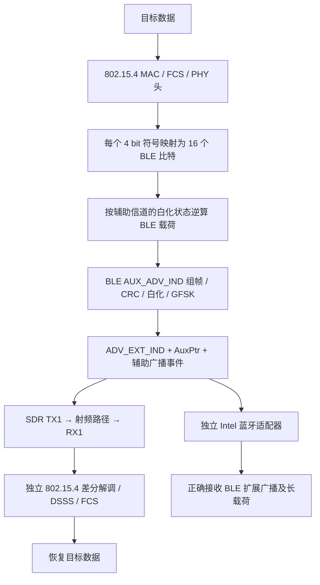

# BLE → 802.15.4 CTC：已完成的 SDR 原型

2026-10-20，全部工作位于 `D:\项目\USRP\ctc_lab`。原有视频、openwifi、固件及 FPGA 工程未改写。

## 当前结论

**已实现 BLE LE 1M 扩展广播承载的 CTC 波形，并在同板射频采样中，由独立的 802.15.4 差分 DSSS 软件接收器恢复完整目标 MAC 帧且 FCS 正确。**电脑内置 Intel 蓝牙芯片也独立收到这组扩展广播，并逐字节核对了三种长载荷。

尚未验证商品 Zigbee/802.15.4 芯片接收，也未实现 Zigbee 入网、BLE 连接、双向 CTC 或 FPGA 实时基带。本结果应称为 **BLE 发射约束下的 SDR CTC 原型**，不能称为已完成商品 BLE→商品 Zigbee 互操作。

## 实验结果与原始证据

| 项目 | 实际结果 | 证据 |
|---|---|---|
| 符号搜索 | 16 种目标符号，每种穷举 65536 个 BLE 比特候选 | [符号报告](artifacts/20261020_150717_333936_ctc_symbols/report.json) |
| 连续 GFSK 边界测试 | 全部 4096 种前驱／目标／后继组合，目标符号 0 错误，最小判决间隔 14 | 同上 |
| 完整扩展事件仿真 | 3/3 种目标帧 FCS 正确；3/3 种 BLE 辅助 PDU CRC 正确 | [完整事件仿真](artifacts/20261020_150717_339710_ctc_simulation/report.json) |
| 扰动实验 | 7 组条件、每组 10 个随机目标载荷，共 70/70；BLE 辅助 PDU 同为 70/70 | [扰动报告](artifacts/20261020_151118_596410_ctc_validation/报告.md) |
| 第一次真实 RF | TX −25 dB，4 段采样，共 5 个目标帧 FCS 正确，覆盖全部 3 种目标载荷 | [第一轮 RF](artifacts/20261020_150737_632018_ctc_rf/report.json) |
| 独立 BLE 芯片 | TX −10 dB；20 秒扫描 7 次目标回调，收到全部 3 种长载荷，逐字节匹配 | [PC 蓝牙接收](artifacts/20261020_150835_189425_pc_ble_scan/report.json) |
| 最终接收器重解析 | 第二轮实际 IQ 中 5 个 FCS 正确目标帧，3/3 种目标载荷和 3/3 种 BLE 辅助 PDU 均匹配 | [综合验收报告](artifacts/20261020_151122_128977_ctc_rf_revalidation/report.json) |

第二轮 RF 原始 IQ：`artifacts/20261020_150805_799991_ctc_rf/rx_00.npy` 至 `rx_03.npy`。综合报告用最终接收器重解析保存的 IQ，没有重新发射或制造采样连续性。

33 项自动化测试覆盖之前的两条基线和新增 CTC；测试清单见 `tests/`。

## 波形如何跨协议



目标 802.15.4 符号占 16 µs，BLE LE 1M 在相同时长内可发 16 bit。每种目标符号对应的 BLE 候选存在失真，本实现通过最大化目标与竞争符号的判决间隔来选择序列，而不是要求波形逐点相同。

对半正弦 O-QPSK，连续 I/Q 芯片峰值间的相位差符号为：

`d[n] = (-1)^(n+1) × c[n-1] × c[n]`，其中 `c[n]` 为 ±1 芯片。

每个符号的第一个差分值依赖前驱符号，接收器将其擦除，其余 31 个值由标准 DSSS 表直接导出。接收器在固定 16 种差分码字间判决；不导入发射映射表，也不读取目标载荷、长度、序号列表或包位置。公开的重复前导码用于盲同步，细定时按相同固定码字与 FCS 选择，不进行知道答案的载荷纠错。

原有相干接收器 `receiver.py` 保持原样。新增 `msk_receiver.py` 是另一种接收实现，对标准 802.15.4 和 CTC 都使用同一份字典与规则。本工程的“31 值擦除解扩”不代表所有商品芯片都采用相同判决逻辑。

## 为什么采用 BLE 扩展广播

仅 3 字节应用数据，采用现有 MAC 头后，PSDU 为 14 字节、加 PHY 头共 20 字节。由于 250 kb/s 目标与 1 Mb/s 源的时长关系，需要 80 字节 BLE 可控区，超过 legacy 广播 31 字节 AdvData。

因此使用有效的扩展事件，而不是超长 legacy 广播或裸 GFSK 序列：

| 配置 | 值 |
|---|---|
| 主广播 | BLE 信道 38，2426 MHz，LE 1M，ADV_EXT_IND |
| 辅助广播 | BLE 通用信道 12，2430 MHz，LE 1M，AUX_ADV_IND |
| 目标 802.15.4 信道 | 16，2430 MHz |
| 射频 LO | 2428 MHz；数字搬频分别 −2 MHz / +2 MHz |
| IQ / 射频滤波带宽 | 8 MSPS / 6 MHz |
| 主包 AuxPtr | 相对主包起始 600 µs，30 µs 单位，指向信道 12 |
| 辅助包起始 | 相对主包起始 615 µs，落在指针接收窗口内 |
| 最小辅助帧间隔 | 要求 ≥300 µs，本实现为 479 µs |
| 名称 / 地址 | `SDR-CTC-TEST` / `C2:54:43:00:00:02` |

两个包分别计算 BLE CRC、按各自信道白化和调制。CTC 码字位于辅助包 Manufacturer Data 内；先根据该区域的白化偏移逆算原始 BLE 载荷，再对完整 PDU 正向 CRC、白化和 GFSK，保证指定的空口比特没有绕过 BLE 发射链。两个尾部保护字节限制最后一个目标符号的边界影响。

本实验的 6 字节应用数据对应 17 字节 PSDU、92 字节映射区。当前无链式分包的封装最多支持 38 字节应用载荷；超过容量会显式拒绝。Manufacturer 标识 `0xFFFF` 仅为本地实验标记，不代表注册厂商。

## 对照与限制

- 同一个固定差分接收器，对历史标准 802.15.4 RF 采样恢复了 9 个有效帧，对普通 BLE RF 采样恢复了 0 个有效目标帧。它们使用各自的中心频率与增益，只是功能对照，不能作公平的吞吐量或灵敏度对比。
- 仿真中的纯噪声、普通 BLE，以及“BLE CRC 正确但目标 FCS 故意破坏”的 CTC 不被接受为正确目标帧；破坏目标 FCS 的源包仍能被 BLE 解码器正确接收。
- 70 个扰动实验包含 15～30 dB SNR、最高 30 kHz 的已测频偏、±20 ppm 时钟误差和最长 38 字节应用载荷，表中各组合仅测 10 帧。不是上述范围全部组合的保证，也未覆盖严重多径。
- TX/RX 使用同一板卡，可能共享时钟、本振参考并存在板内射频泄漏；不等于独立 Zigbee 设备的空口互操作或远距离测试。
- 循环发送、分块采集及 PC 回调过滤都使真实发包分母不确定，因此不报告 100% 空口 PRR 或实际净吞吐量。
- 每符号理想的 250 kb/s 目标比特率，不等于本原型的有效应用速率。当前每轮只发三个短载荷，用于验证机制。
- 扩展事件是有限缓冲重放，未实现完整 GAP 控制器。真实 Intel 蓝牙芯片的接收证明当前事件可被该接收机接受，不构成全面 Bluetooth 认证。

## 复现命令

在 `D:\项目\USRP\ctc_lab` 中运行，使用本工程独立 `.venv`：

```powershell
# 不发射：测试、符号映射、完整事件仿真和扰动实验
.\.venv\Scripts\python.exe -m pytest -q
.\.venv\Scripts\python.exe ctc_run.py symbols
.\.venv\Scripts\python.exe ctc_run.py simulate
.\.venv\Scripts\python.exe validate_ctc.py

# 短时实际发射，完成采集后立即停发，再解码
.\.venv\Scripts\python.exe ctc_run.py rf --uri usb:1.5.5 --blocks 4 --tx-gain -25

# 独立解析保存的 RF IQ，不访问发送清单
.\.venv\Scripts\python.exe ctc_run.py decode '.\artifacts\20261020_150805_799991_ctc_rf\rx_00.npy'
```

需要再次验证独立 BLE 适配器时，在一个终端启动 45 秒限时发射，另一个终端启动扫描：

```powershell
.\.venv\Scripts\python.exe ctc_run.py rf --uri usb:1.5.5 --blocks 4 --tx-gain -10 --seconds 45
.\.venv\Scripts\python.exe scan_ble.py --seconds 20 --name SDR-CTC-TEST --address C2:54:43:00:00:02
```

这两个命令分别在两个终端运行，前者先启动。不要与其他射频程序同时占用 SDR。USB URI 可随插拔变化，先运行 `python -m ctc_lab devices` 检测。

每轮写入新时间目录。`artifacts/ctc_active.json` 中的 `stop_file` 指向该轮的 STOP 文件；在需要提前停发时，向该路径写入任意内容即可，程序每 0.2 秒检查并在退出时销毁缓冲。测试完成后已有发射均已停止。

## 后续最有价值的工作

1. 在现有 SDR 上扩大随机载荷、功率、频偏和多径条件的统计测试，增加持续定时跟踪；以当前结果为基线，避免直接宣称论文级性能。
2. 用独立 802.15.4 商品接收芯片检查兼容性，尤其是不同同步、频偏估计及 DSSS 判决实现。现有设备还不能完成这一项。
3. 若需要更大应用数据，增加合法 AUX_CHAIN_IND 或应用层分片，分别报告协议开销与净吞吐量。

## 依据

- [Bluetooth Core Link Layer](https://www.bluetooth.com/wp-content/uploads/Files/Specification/HTML/Core-60/out/en/low-energy-controller/link-layer-specification.html)：扩展 PDU、ADI、AuxPtr、白化、CRC 与辅助时序。
- [Bluetooth LE 官方测试向量](https://www.bluetooth.com/wp-content/uploads/Files/Specification/HTML/Core-60/out/en/low-energy-controller/sample-data.html)：已有 CRC、白化和位序测试基础。
- [TI SWRU191F](https://www.ti.com/lit/ug/swru191f/swru191f.pdf)：标准 802.15.4 芯片序列与调制。
- [BlueBee，SenSys 2017](https://doi.org/10.1145/3131672.3131678)：相位与 DSSS 容错的研究出发点；本工程实现与验收以源码和原始报告为准。
