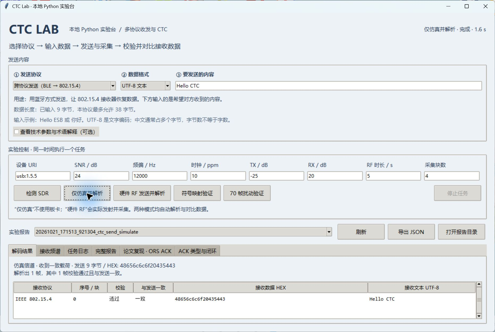
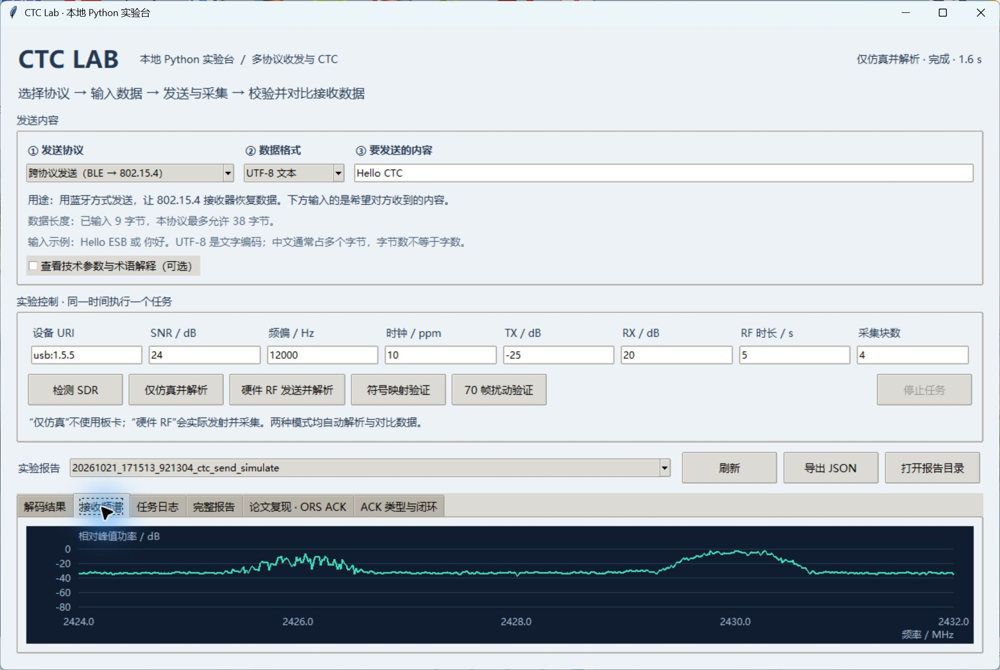
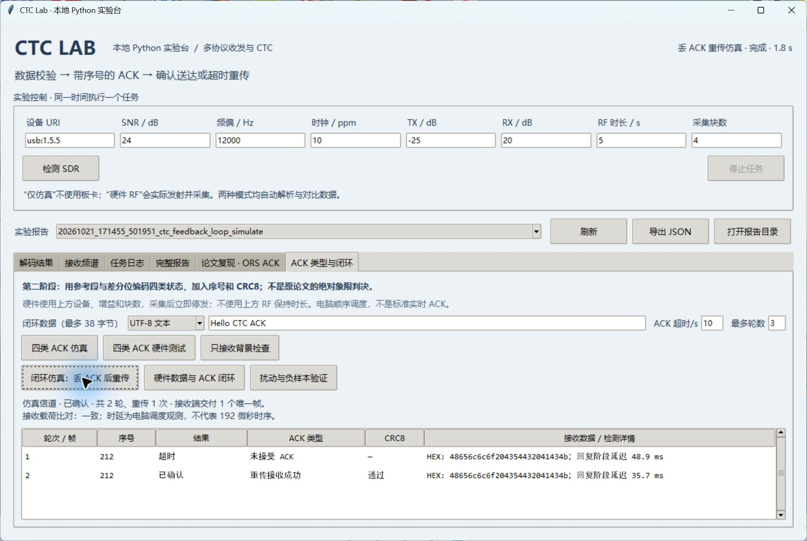

# CTC 独立实验工程

当前已实现 **BLE → 802.15.4 的 SDR CTC 原型**：BLE 扩展广播的长载荷经过映射、CRC、白化与 GFSK 发射后，由独立差分 DSSS 软件接收器从实际 RF IQ 中恢复目标 MAC 帧并通过 FCS。独立 Intel 蓝牙适配器也逐字节确认了全部 3 种源载荷。详情、证据及命令见 [CTC 阶段报告](CTC阶段报告.md)。尚未验证商品 Zigbee 芯片接收，也未实现 Zigbee 入网或双向 CTC。

前两阶段基线也已完成：标准 802.15.4 射频收发；BLE legacy 广播获安卓手机名称和 `ABCDEF01` 载荷确认，见 [BLE 手机验证](BLE手机验证.md)。测试发射均已停止。

本地 Python 桌面实验台：双击 `start_desktop.bat`，无需浏览器，可直接查看报告、保存的 IQ 频谱及帧结果，并运行仿真、检测板卡或启动限时 RF 测试。详见 [桌面程序使用说明](桌面程序使用说明.md)。原网页版本仍保留，入口为 `start_dashboard.bat`。

桌面程序可选择 BLE 广播、标准 IEEE 802.15.4 或 BLE → 802.15.4 CTC，输入 UTF-8 / HEX 数据后选择仿真或 RF 发送并解析，查看接收 HEX、文本、校验与载荷一致性。三种路线的自定义数据上限分别为 10、116、38 字节。

新增 Nordic ESB（1M / 无应答）：2440 MHz、最多 32 字节载荷、动态长度和 CRC16。仿真及实际同板 RF 收发已通过，独立 nRF24 芯片互通尚未验证，详见桌面程序使用说明。

新增“论文复现 · ORS ACK”页：OQPSK→BLE 相位差间隔的 ACK 存在性实验，支持仿真、RF、仅接收背景对照与负样本验证。当前不判决 ACK 类型、不传载荷，也未接入数据触发回复闭环。验收结果与操作见 [ORS ACK 使用说明](ORS_ACK使用说明.md)。

第二阶段另见“ACK 类型与闭环”页：相位参考、序号、CRC8 的自定义 ORS 扩展，支持四类状态、丢 ACK 重传仿真与数据 FCS 触发的同板 RF 闭环。已经通过实际 RF，但主机调度约为秒级，不是原论文逐行复现或 192 微秒实时 ACK。见 [ACK 类型与闭环使用说明](ACK类型与闭环使用说明.md)。

## 程序截图

以下为本地 Python 桌面程序实际运行截图，均来自仿真任务。

**跨协议发送与解析：**输入 `Hello CTC`，由 BLE 波形承载目标数据，802.15.4 软件接收器恢复载荷，FCS 通过且内容一致。



**接收频谱：**查看同一次仿真保存的 IQ，展示 2426 MHz 主广播与 2430 MHz 辅助广播的频谱；纵轴为相对峰值功率。



**ACK 超时重传：**人为丢弃首个 ACK，第一轮超时、第二轮确认成功；接收端仅交付一个唯一帧。



## 本机已经完成的验证

- 当前包含多协议收发、CTC、ORS 与 ACK 闭环，共 91 项自动化测试通过。
- CTC 的 16 种符号及全部 4096 种前驱／目标／后继组合通过；完整事件 70 个扰动仿真帧均通过。
- CTC 真实 RF 得到 5 个有效目标帧，覆盖全部 3 种目标载荷；独立 Intel 蓝牙芯片接收并匹配全部 3 种 BLE 源载荷。综合证据见 [CTC 验收](artifacts/20261020_151122_128977_ctc_rf_revalidation/report.json)。
- 6 组仿真条件，每组 5 个随机载荷，合计 30/30 正确恢复并通过 FCS。
- 3 段纯噪声输入未检出帧；故意破坏 FCS 的帧不会被接受。
- 真实板卡：`usb:1.5.5`，设备报告 `PlutoSDR Rev.C (Z7010-AD9361)`、固件 `v0.38`。
- 实际射频测试：8 MSPS、2425 MHz（802.15.4 信道 15）、TX1/RX1、TX −40 dB / RX 20 dB，`loopback=0`。
- 两段各 262144 点的采集得到 16 个完整帧，16 个 FCS 均通过，覆盖全部 3 种发送载荷，没有异常载荷。

真实射频结果见 [RF 报告](artifacts/20261020_143641_206083_rf_loopback/report.json)，原始采样为同目录 `rx_00.npy`、`rx_01.npy`。仿真验收见 [仿真报告](artifacts/20261020_143532_036933_validation/报告.md)。

**结果边界：**数字回环已关闭，但同板结果可能包含天线耦合或板内射频泄漏；未证明独立设备、远距离或复杂多径条件。循环发送和分块采集无法确定精确发包分母，报告不计算真实空口 PRR。16 个循环接收帧不等于 16 个独立随机载荷。

## 运行

在 PowerShell 中进入本文件夹：

```powershell
Set-Location 'D:\项目\USRP\ctc_lab'
```

本机已创建独立 `.venv`。GitHub 版本不包含虚拟环境、原始 IQ、论文全文和第三方 DLL；克隆后先执行：

```powershell
powershell -ExecutionPolicy Bypass -File .\setup.ps1
```

仿真不需要板卡。Windows 硬件收发另需准备 libiio 0.25 及其依赖，将 `CTC_IIO_LIB_DIR` 指向含 `libiio.dll` 的目录；本机 `native/` 的第三方二进制不随仓库发布，见 [运行库来源](native/来源.md)。精简实验报告保存在仓库 `artifacts/` 的选定文件中，报告提到的本机绝对路径和原始 IQ 不随代码上传。

全部命令使用本工程 Python，不安装到全局环境。

### 仿真

```powershell
.\.venv\Scripts\python.exe -m ctc_lab simulate
.\.venv\Scripts\python.exe validate.py
.\.venv\Scripts\python.exe -m pytest -q
```

`simulate` 默认 3 帧、20 dB SNR、37.5 kHz 频偏、20 ppm 时钟偏差、173.25 点延时。噪声功率按有效信号功率计算，避免把静默区稀释成虚高 SNR。

每次运行在 `artifacts/日期时间_任务/` 下建立新目录，保存 IQ、发送清单和报告。时间目录使用 UTC+8。

### 只生成 IQ 或独立解码文件

```powershell
.\.venv\Scripts\python.exe -m ctc_lab generate --frames 3
.\.venv\Scripts\python.exe -m ctc_lab decode '.\artifacts\20261020_143641_206083_rf_loopback\rx_00.npy'
```

IQ 使用 NumPy 一维 `complex64`，约定 `I + jQ`；同名 JSON 保存采样率和样点数。`decode` 只读取 IQ 和采样率，不访问发送清单。它也能解析此 MAC 子集之外的 FCS 状态，但只为本项目使用的 MAC 子集提取应用载荷。

### 板卡检测及射频测试

```powershell
.\.venv\Scripts\python.exe -m ctc_lab devices
.\.venv\Scripts\python.exe -m ctc_lab rf-loopback --uri usb:1.5.5 --frames 3 --blocks 2 --tx-gain -40 --rx-gain 20
```

USB URI 可能随重新插拔变化。板卡刚启动时扫描可能失败，待启动完成再检测。`devices` 不发射；`rf-loopback` 会实际发射，在采集结束后先停止发射再进行解码，并在异常退出时清理缓冲。测试前退出其他占用板卡的收发程序。

接口说明：`--channel` 为 802.15.4 信道（11..26），`--rf-channel` 为射频路径（0=TX1/RX1，1=TX2/RX2）。初期使用天线耦合与低发射增益；TX/RX 不能无衰减直接接线。

Windows libiio 0.25 及依赖的本机副本位于 `native/`，Python 绑定固定为 `pylibiio==0.25`。它们从本机已有运行库只读复制，来源和许可证见 `native/来源.md`、`native/LICENSE-libiio.txt`。如需使用其他同版本运行库目录，可设置仅供本工程使用的 `CTC_IIO_LIB_DIR` 环境变量。

退出码：0=本命令的验收条件通过；2=解码完成但缺少期望有效帧；1=配置或运行错误。`generate` 和 `devices` 的 0 不表示射频收发成功。

## 实现结构

| 文件 | 功能 |
|---|---|
| `ctc_lab/ieee802154.py` | 16 种标准 DSSS 序列、低半字节优先映射、MAC/FCS、半正弦 O-QPSK |
| `ctc_lab/receiver.py` | 前导码归一化相关检测、频偏搜索与精估计、I/Q 匹配滤波、DSSS 解扩、SFD/长度/FCS 解析 |
| `ctc_lab/channel.py` | 固定相位、分数延时、白噪声、频偏和采样时钟偏差 |
| `ctc_lab/radio.py` | AD936x/libiio 适配、物理 RF 收发、缓冲生命周期管理 |
| `ctc_lab/storage.py` | IQ 和 JSON 报告保存 |
| `ctc_lab/ble.py` | BLE CRC、白化、广播组帧、GFSK 波形及广播周期 |
| `ctc_lab/ble_receiver.py` | 不依赖发送载荷的 BLE LE 1M IQ 接收与 CRC 检查 |
| `ctc_lab/ble_commands.py` | BLE 波形生成、限时发射和停止控制 |
| `ctc_lab/msk_receiver.py` | 从标准 O-QPSK 导出的固定差分 DSSS 接收器，接收端不读取映射表 |
| `ctc_lab/ctc_mapper.py` | 穷举符号映射、目标帧映射和容量计算 |
| `ctc_lab/ble_extended.py` | 合法长度的扩展 PDU、逆白化及主／辅助广播事件组装 |
| `ctc_lab/extended_receiver.py` | 独立解析 BLE 扩展 PDU 的 IQ 接收器 |
| `ctc_lab/ctc_experiment.py` | 盲接收与事后验收的边界、频率搬移和信道滤波 |
| `ctc_run.py` | CTC 符号、仿真、RF 和文件解码命令 |
| `validate_ctc.py` | 70 帧扰动与负例实验 |
| `revalidate_ctc_rf.py` | 重解析已保存 IQ，逐字节核对独立 PC 蓝牙证据 |
| `validate.py` | 可复现的 6 组仿真验收 |
| `tests/` | 标准约定、独立 CRC 校验值、接收负例和资源清理测试 |

接收算法仅使用公开前导码进行同步，输入无发送载荷、长度、序号列表或位置。DSSS 解扩在 16 个标准码字间做相关判决。当前为批量离线接收，没有持续采样时钟跟踪、复杂多径均衡或实时性能保证；特别是长帧叠加较大时钟偏差，需后续添加定时跟踪。

基线 802.15.4 采样率要求为 2 MHz 的整数倍且不小于 4 MHz，默认 8 MHz；当前 CTC 频率计划使用 8 MHz。MAC 仅发送无安全、无 ACK、PAN 压缩、16 bit 源/目标地址的数据帧，固定帧控制 `0x8841`，普通 802.15.4 基线载荷最多 116 字节，当前无链式 BLE 扩展封装的 CTC 应用载荷最多 38 字节。不进行 Zigbee 入网或应用命令发送。

## 后续路线与验收门槛

1. 已完成两条标准基线、CTC 映射、合法长度的 BLE 扩展封装、固定接收器的仿真／RF 试验及独立 BLE 芯片确认。
2. 扩大功率、频偏、随机载荷和多径条件的统计测试，增加持续定时跟踪；当前有限实验不等于全部条件保证。
3. 有真实 802.15.4 芯片时补互操作验证。软件差分接收器不能替代商品芯片验证。
4. 大数据传输需实现合法的 AUX_CHAIN_IND 或应用层分片，并测量实际开销与净吞吐量。

## 参考依据

- [TI CC253x/4x User's Guide, SWRU191F](https://www.ti.com/lit/ug/swru191f/swru191f.pdf)：2.4 GHz 调制、表 23-2 的 C0..C31 芯片顺序。
- [gr-ieee802-15-4](https://github.com/bastibl/gr-ieee802-15-4)：用于交叉核对 MAC/FCS 约定；本工程没有复制其实现源码。
- [ADI pyadi-iio 缓冲说明](https://analogdevicesinc.github.io/pyadi-iio/buffers/index.html)：循环发送与缓冲释放。
- [Bluetooth Core Link Layer](https://www.bluetooth.com/wp-content/uploads/Files/Specification/HTML/Core-60/out/en/low-energy-controller/link-layer-specification.html)：后续 BLE 帧约束。

当前代码是研究原型，不构成协议认证或芯片兼容性声明。
